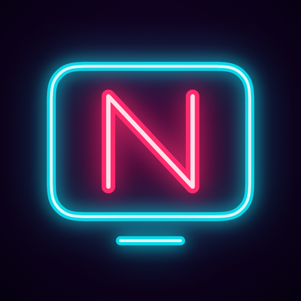

# Nightglass



Lecteur IPTV natif pour macOS. Le portage Windows (Tauri + libmpv) est en cours dans [windows/](windows/README.md).

## Stack

- **SwiftUI** (macOS 26+) pour l'UI : Liquid Glass, materials, animations et `matchedGeometryEffect`, 100 % natif.
- **[AetherEngine](https://github.com/superuser404notfound/AetherEngine)** pour la lecture : FFmpeg lit le flux, VideoToolbox décode sur le GPU, AVPlayer affiche. Lit MPEG-TS, HLS, MKV, HEVC, AC3/EAC3, HDR et Dolby Vision, avec timeshift pour le live. Fournit une vue SwiftUI (`AetherPlayerSurface`) sans contrôles imposés. Licence LGPL-3.0 avec exception App Store.
- **URLSession** pour les appels aux fournisseurs.
- **Keychain** pour les sources (elles contiennent des mots de passe). Catalogues et guide sont rechargés au lancement.

## Sources supportées

| Source | Comment |
|---|---|
| M3U / M3U8 | Fichier local ou URL. Parse `#EXTINF` (`tvg-id`, `tvg-name`, `tvg-logo`, `group-title`, `catchup*`), `#EXTVLCOPT` (user-agent, referrer). |
| Xtream Codes | `player_api.php` : catégories et flux live/VOD/séries, `get_series_info`, `get_short_epg`, `xmltv.php`. URLs de lecture construites à partir de `username/password/stream_id`. |
| Stalker / MAG portal | `portal.php` avec adresse MAC : `handshake` → `get_profile` → `itv/get_genres` / `get_all_channels` → `create_link`. |
| XMLTV (EPG) | URL fournie par la playlist (`url-tvg`), par Xtream ou saisie à la main. Parsing en flux avec `XMLParser` (fichiers de plusieurs centaines de Mo, souvent gzippés). |

## Fonctionnalités du MVP

1. Ajouter / gérer plusieurs sources (M3U, Xtream, Stalker).
2. TV en direct : catégories, recherche, favoris, zapping.
3. VOD et séries (saisons, épisodes, reprise de lecture).
4. EPG : maintenant / ensuite + grille.
5. Lecteur : plein écran, pistes audio et sous-titres, raccourcis clavier.

Hors MVP : enregistrement, catch-up, multi-écran, AirPlay, version Windows.

## Architecture

```
NightglassCore/   # Swift package sans UI : clients m3u, xtream, stalker, xmltv + modèles communs
Nightglass/       # app macOS SwiftUI : écrans, lecteur AetherEngine
NightglassUITests/ # test d'interface de bout en bout
Scripts/          # mock-xtream.py : faux serveur Xtream (films Blender) ; make-icon.swift : génère l'icône
project.yml       # projet Xcode, généré par XcodeGen
```

Chaque client de `NightglassCore` transforme son protocole en modèles communs (`Channel`, `Movie`, `Series`, `Programme`) : l'UI ne sait pas d'où viennent les chaînes. `NightglassCore` ne dépend que de Foundation : il est testable en ligne de commande et réutilisable pour une future version Windows.

## Compiler et lancer

```bash
brew install xcodegen
xcodegen generate
xcodebuild -project Nightglass.xcodeproj -scheme Nightglass -derivedDataPath build build
open build/Build/Products/Debug/Nightglass.app
```

Il faut macOS 26 et Xcode 26 ou plus récent. Ou bien ouvrir `Nightglass.xcodeproj` dans Xcode après `xcodegen generate`.

## Tests

```bash
cd NightglassCore && swift test
```

Tests d'intégration (facultatifs, contre de vrais serveurs) :

```bash
NG_M3U=https://iptv-org.github.io/iptv/countries/fr.m3u \
NG_XTREAM=http://127.0.0.1:9191 NG_XTREAM_USER=… NG_XTREAM_PASS=… swift test
```

Test d'interface (XCUITest) : il ajoute les sources au clic depuis l'écran Sources, attend le guide, clique sur Arte et vérifie que le moteur a bien affiché une image, en aperçu puis en plein écran. Il utilise un compte de trousseau à part et ne touche pas à tes sources.

```bash
TEST_RUNNER_NG_XC_PASS=<mot de passe XC Dispatcharr> xcodebuild -project Nightglass.xcodeproj -scheme Nightglass -derivedDataPath build test
```

En Debug, l'app accepte des variables d'environnement de test (`NG_SEED`, `NG_PLAY`, `NG_PLAY_MOVIE`, `NG_SHOTS`…), décrites dans `Nightglass/DebugAutomation.swift`.

## Design

Voir [DESIGN.md](DESIGN.md) : un style néon sobre, sans décoration.

## Sources de test

- M3U : playlists publiques de [iptv-org/iptv](https://github.com/iptv-org/iptv), par exemple `https://iptv-org.github.io/iptv/index.m3u` (toutes les chaînes) ou `https://iptv-org.github.io/iptv/countries/fr.m3u` (France).
- EPG : `https://xmltvfr.fr/xmltv/xmltv.xml` (identifiants compatibles avec iptv-org). Le préréglage « iptv-org · France » de l'écran Sources remplit les deux URL.
- Xtream (direct) : [Dispatcharr](https://github.com/Dispatcharr/Dispatcharr) en Docker (`docker run -d -p 127.0.0.1:9191:9191 --name dispatcharr -v dispatcharr_data:/data ghcr.io/dispatcharr/dispatcharr:latest`). Dans son interface : ajouter la playlist iptv-org France comme compte M3U, `https://xmltvfr.fr/xmltv/xmltv.xml` comme source EPG, créer les chaînes à partir des flux, puis un utilisateur avec un mot de passe XC. Il expose alors une vraie API Xtream Codes en local.
- Xtream (films, séries) : `python3 Scripts/mock-xtream.py` sert les films libres de la Blender Foundation sur `http://127.0.0.1:9292`, avec l'identifiant `demo` / `demo`.
- Stalker : pas de serveur open source. Les tests du client s'appuient sur des réponses enregistrées (fixtures) servies par un mini serveur local.

## Ce qui existe déjà

- [IPTVnator](https://github.com/4gray/iptvnator) : Electron + Angular, M3U/Xtream/Stalker, lecture web ou mpv/VLC externe.
- [Movena](https://github.com/movena-app/movena) : Tauri + libmpv intégré, Xtream/M3U.
- Plusieurs apps IPTV Apple (KIPTV, Snappier, LillyPlayer…) tournent sur AetherEngine.

## Licence

Le code de Nightglass est sous licence MIT : voir [LICENSE](LICENSE).

Les moteurs de lecture gardent leur propre licence :

- **AetherEngine** (macOS) : LGPL-3.0, avec une exception pour l'App Store.
- **libmpv** (Windows) : la variante LGPL de [zhongfly/mpv-winbuild](https://github.com/zhongfly/mpv-winbuild), soit mpv sous LGPL-2.1+ et FFmpeg sous LGPL-3.0+. Elle est chargée à l'exécution et n'est pas versionnée ici. Un installeur qui embarque `libmpv-2.dll` doit joindre ces licences et indiquer où obtenir leurs sources.
