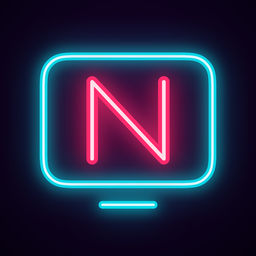

# Nightglass

Lecteur IPTV pour Windows et macOS : une seule app, **Tauri 2** (Rust) + **Svelte 5** + **libmpv**, dans [windows/](windows/README.md) (compiler, lancer, publier une version).

## Sources supportées

| Source | Comment |
|---|---|
| M3U / M3U8 | Fichier local ou URL. Parse `#EXTINF` (`tvg-id`, `tvg-name`, `tvg-logo`, `group-title`, `catchup*`), `#EXTVLCOPT` (user-agent, referrer). |
| Xtream Codes | `player_api.php` : catégories et flux live/VOD/séries, `get_series_info`, `xmltv.php`, replay (`tv_archive`). URLs de lecture construites à partir de `username/password/stream_id`. |
| Stalker / MAG portal | `portal.php` avec adresse MAC : `handshake` → `get_profile` → `itv/get_genres` / `get_all_channels` → `create_link`. |
| XMLTV (EPG) | URL fournie par la playlist (`url-tvg`), par Xtream ou saisie à la main. Lu en flux (fichiers de plusieurs centaines de Mo, souvent gzippés). |

## Design

Voir [DESIGN.md](DESIGN.md) : le style « nuit ».

## Sources de test

- M3U : playlists publiques de [iptv-org/iptv](https://github.com/iptv-org/iptv), par exemple `https://iptv-org.github.io/iptv/countries/fr.m3u` (France).
- EPG : `https://xmltvfr.fr/xmltv/xmltv.xml` (identifiants compatibles avec iptv-org).
- Xtream (direct) : [Dispatcharr](https://github.com/Dispatcharr/Dispatcharr) en Docker (`docker run -d -p 127.0.0.1:9191:9191 --name dispatcharr -v dispatcharr_data:/data ghcr.io/dispatcharr/dispatcharr:latest`). Dans son interface : ajouter la playlist iptv-org France comme compte M3U, `https://xmltvfr.fr/xmltv/xmltv.xml` comme source EPG, créer les chaînes à partir des flux, puis un utilisateur avec un mot de passe XC. Il expose alors une vraie API Xtream Codes en local.
- Xtream (films, séries) : `python3 windows/scripts/mock-xtream.py` sert les films libres de la Blender Foundation sur `http://127.0.0.1:9292`, avec l'identifiant `demo` / `demo`.

## Ce qui existe déjà

- [IPTVnator](https://github.com/4gray/iptvnator) : Electron + Angular, M3U/Xtream/Stalker, lecture web ou mpv/VLC externe.
- [Movena](https://github.com/movena-app/movena) : Tauri + libmpv intégré, Xtream/M3U.

## Licence

Le code de Nightglass est sous licence MIT : voir [LICENSE](LICENSE).

libmpv garde sa propre licence. Les deux apps embarquent une build LGPL, chargée à l'exécution et non versionnée ici : mpv sous LGPL-2.1+ et FFmpeg sous LGPL-3.0+.

- Windows : la variante LGPL de [zhongfly/mpv-winbuild](https://github.com/zhongfly/mpv-winbuild).
- macOS : la build `video-full` de [media-kit/libmpv-darwin-build](https://github.com/media-kit/libmpv-darwin-build).

Les deux apps joignent ces licences et indiquent où obtenir les sources ([windows/licenses/](windows/licenses/THIRD-PARTY-NOTICES.txt)).
